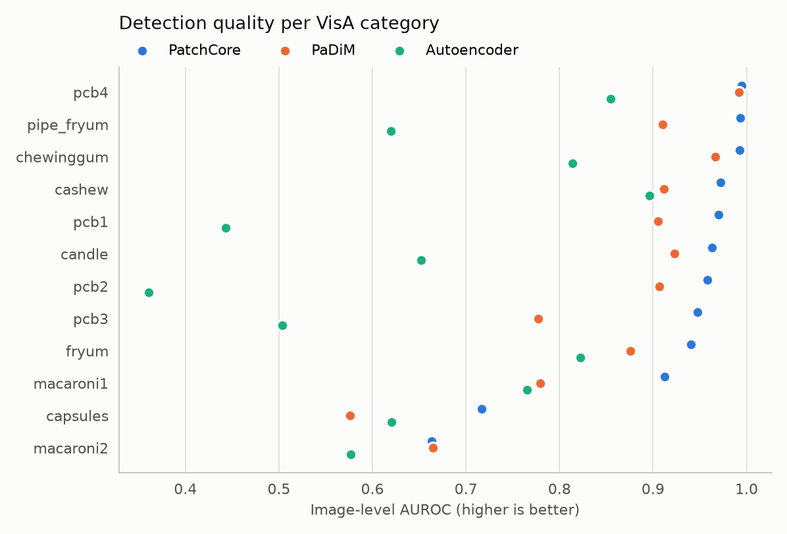
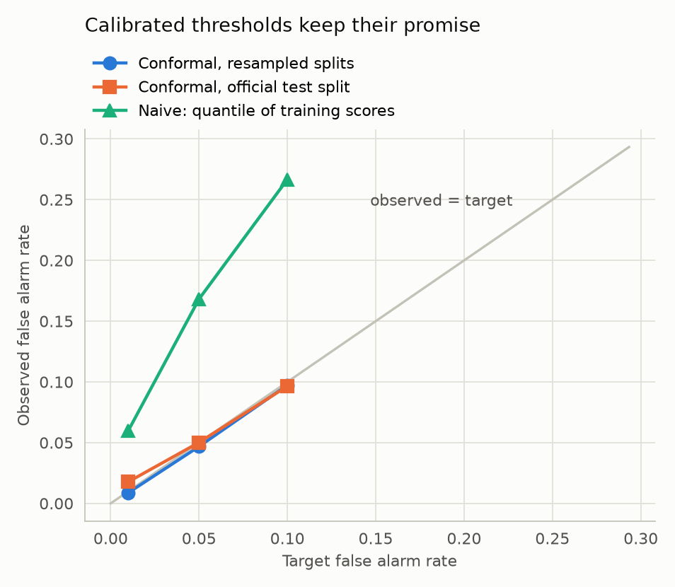
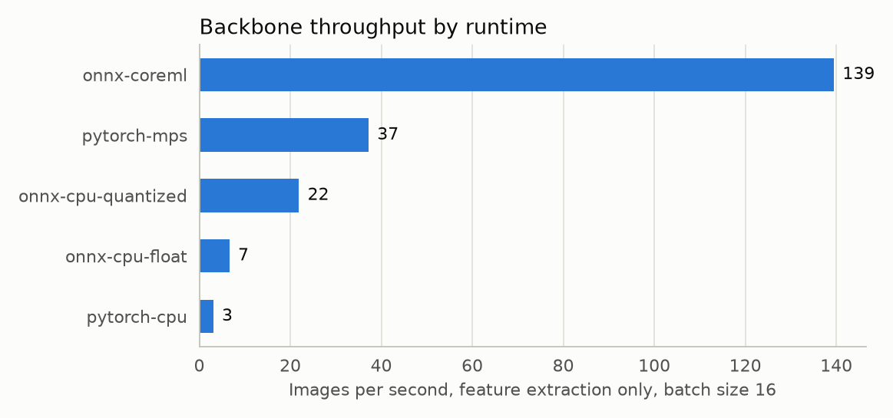
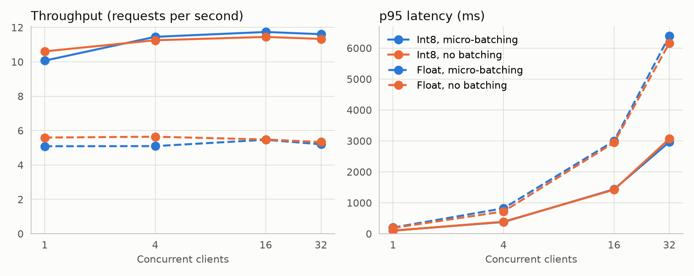
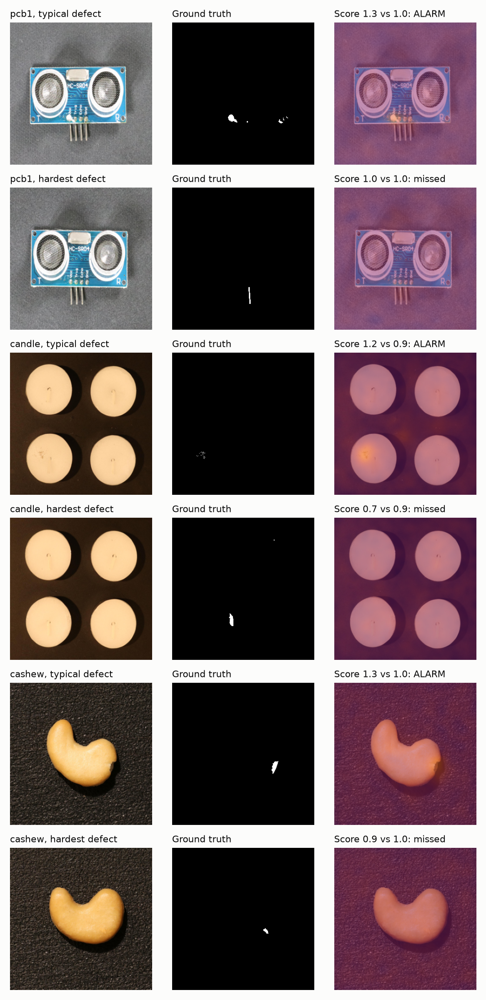
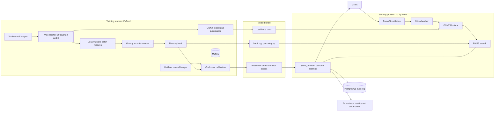
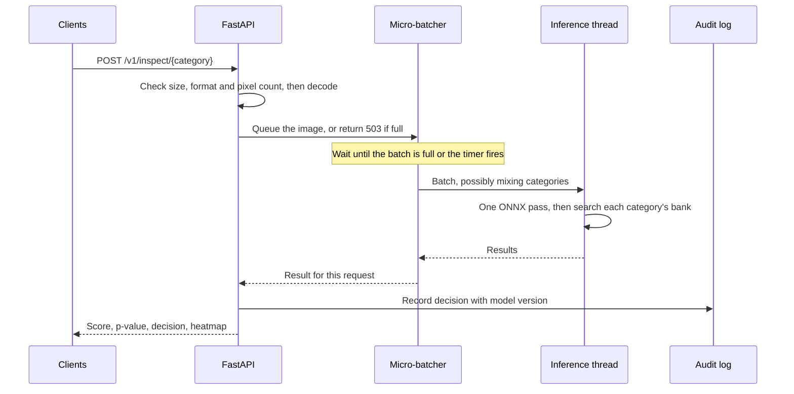

# PatchSentry

**Unsupervised visual anomaly detection for industrial inspection, with calibrated false alarm rates.**

PatchSentry learns what good parts look like and flags anything that deviates, with no defect labels
needed. It combines a from-scratch PatchCore implementation, alarm thresholds set by conformal
prediction, and a PyTorch-free FastAPI service that runs ONNX Runtime and FAISS with dynamic
micro-batching.

[](https://github.com/youssefhipa/patchsentry/actions/workflows/ci.yml)


> Every number in this README comes from a script in this repository, on the public VisA dataset.
> The tables are generated from [`reports/`](reports/) by `make report`, not typed by hand.

---

## Project status and handoff

**To continue this work (human or AI): read this section, then carry on from "Next step".**
Update this section whenever a step is finished, including anything that failed.

| # | Step | Status |
|---|------|--------|
| 1 | Choose project and write this plan | Done |
| 2 | Inspect environment | Done |
| 3 | Scaffold repository, dependencies, git | Done |
| 4 | Download dataset | Done: 10,821 samples, no missing files |
| 5 | Data ingestion and preprocessing | Done |
| 6 | Baselines: autoencoder, PaDiM, image-level k-NN | Code done, run in step 8 |
| 7 | PatchCore | Done: first check on `pcb1` worked |
| 8 | Sweep on development categories, then full model comparison | Sweep done (320 px adopted, `configs/default.yaml`); **comparison running** |
| 9 | Build bundle: ONNX, quantisation, conformal calibration, drift check | Code done, not run |
| 10 | Verify the serving path; latency, throughput and load benchmarks | Code done, not run |
| 11 | FastAPI service | Done and tested on a small synthetic bundle |
| 12 | pytest, ruff, mypy | Passing (107 tests); rerun before publishing |
| 13 | Docker, Compose, GitHub Actions | Written, **not yet run**: Docker's VM did not respond while the sweep held the RAM; retry after training |
| 14 | Final README: results, figures, CV bullets | In progress |
| 15 | Secret scan, publish public GitHub repo | Not started |

**Next step:** a chained background job runs `make benchmark bundle verify bench loadtest`, logging to
`~/.local/share/patchsentry/chain.log`. When it finishes, run `make figures report`, check the README
tables, retry Docker (build the image, then `docker compose up`), rerun tests and lint, then publish.
If the chain died, rerun just the failed target: each one writes its own report in `reports/`.

**Machine notes (read before running anything on the author's Mac)**
- This folder is on the iCloud-synced Desktop and the disk is nearly full, so macOS evicts files to the
  cloud. A virtualenv here hangs on import, with 0% CPU, while files download again. So heavy files live
  outside iCloud in `~/.local/share/patchsentry` (`venv/`, `data/`, `artifacts/`); `data` and `artifacts`
  here are symlinks to it.
- Run commands with `export UV_PROJECT_ENVIRONMENT=~/.local/share/patchsentry/venv`, and call
  `~/.local/share/patchsentry/venv/bin/python` directly. Do not create `.venv` in this folder.
- 16 GB RAM (the brief says 24), about 3 GB free disk. Docker Desktop holds 39 GB of the user's own images
  and volumes: never prune them. Quit Docker while training, to free its RAM.

**Rules for this project**
- Never fabricate or estimate a result. Tables come from `reports/`, written by committed scripts.
- Never claim something works unless it was run. If something could not be run, say so here.
- Never commit secrets, `.env` files, datasets or large model weights.

---

## Why this project

Production lines have plenty of images of good parts and very few of defects, and new defect types keep
appearing. A supervised detector can't catch a defect it never saw. Getting a model to work is only half
the problem in a real deployment, though:

| Question from the factory | Usual answer | PatchSentry |
|---|---|---|
| How many false alarms will this raise? | A threshold tuned on test data, with no guarantee | Conformal threshold with a finite-sample bound, checked empirically |
| Is the threshold still valid next month? | Nobody checks until complaints arrive | Live drift monitor on conformal p-values |
| Can it keep up with the line? | One benchmark number | Latency and throughput per runtime, plus a load test over HTTP |
| Why did it raise an alarm? | A score | A pixel heatmap and a full audit record |

## Results

Hyperparameters were tuned on **four development categories only**. The headline numbers come from the
**eight held-out categories**, which never influenced any decision. Most anomaly detection results tune on
the reported test set, so they are optimistic by comparison.

### Model comparison

Mean over the eight held-out categories; PatchCore is also averaged over three coreset seeds.

<!-- results:models -->
*Pending.*
<!-- /results:models -->



<details>
<summary>Per-category results</summary>

<!-- results:per_category -->
*Pending.*
<!-- /results:per_category -->
</details>

### Calibrated false alarm rates

<!-- results:conformal -->
*Pending.*
<!-- /results:conformal -->



### Inference performance

Measured on an Apple M3 MacBook Air (16 GB) with real VisA images. No GPU server was available, so CUDA
and TensorRT are **not** benchmarked here.

**Feature extraction by runtime**

<!-- results:backbone -->
*Pending.*
<!-- /results:backbone -->



**Nearest-neighbour search**

<!-- results:index -->
*Pending.*
<!-- /results:index -->

**Quantisation, measured through the deployed path on all 12 categories**

<!-- results:quantization -->
*Pending.*
<!-- /results:quantization -->

**Load test over HTTP**, with the client on the same machine

<!-- results:loadtest -->
*Pending.*
<!-- /results:loadtest -->



### Drift monitoring

<!-- results:drift -->
*Pending.*
<!-- /results:drift -->

### Hyperparameter sweep

One change at a time from the baseline, on the development categories.

<!-- results:sweep -->
*Pending.*
<!-- /results:sweep -->

### Example detections

For each category: a typical detection, then the hardest defect, so that failures are visible too.



## Architecture





## How it works

**PatchCore** (Roth et al., CVPR 2022). Mid-level CNN features, average-pooled over a small neighbourhood,
describe each image patch. A memory bank stores what normal patches look like. An image's score comes from
its most unusual patch, meaning the one furthest from any bank entry, scaled down if the matching entry is
itself isolated, since it may be a rare outlier.

**Greedy k-center coreset.** Storing every patch is too slow, so the bank keeps a subset chosen by repeatedly
adding the point furthest from those already chosen. This 2-approximates the optimal covering radius, and
unlike random sampling it keeps rare but normal appearance. A Johnson-Lindenstrauss random projection makes
each step cheaper.

**Split conformal calibration.** Given held-out normal scores `s_1..s_n` that are exchangeable with a new normal
image's score, choosing the threshold as the `k`-th smallest score, where `k = ceil((n+1)(1-alpha))`, gives
`P(false alarm) <= alpha` for any distribution. Two limits matter, and both are measured here:

- The bound averages over calibration sets. For one fixed set, the true rate follows `Beta(n+1-k, k)`.
- It assumes exchangeability, which breaks when the line drifts. The official VisA test split can
  also differ from its training split. That's why the results show both resampled and official-split rates.

**Drift monitor.** Normal images give approximately uniform conformal p-values. The service runs a
Kolmogorov-Smirnov test on a rolling window to detect a shift in the score distribution, without needing labels.

**Micro-batching.** A batched forward pass costs less per image. The first request in an empty queue starts a
short timer, and requests arriving meanwhile share its batch. Under light load, the extra wait is at most the
timer. Under heavy load, batches fill before it fires.

## Technical decisions and trade-offs

| Decision | Why | Cost |
|---|---|---|
| Tune on 4 categories, report on 8 others | An unbiased estimate; test sets stay untouched | Settings aren't optimal per category |
| Hold out 25% of normal images for calibration | Images in the bank score near zero, which would void the guarantee | A smaller memory bank pool |
| Conformal threshold, not a tuned one | Needs no defect examples and has a provable bound | Controls false alarms only; recall is whatever results |
| Serving image without PyTorch | Smaller image, and export parity is tested instead of assumed | Two runtimes to keep consistent |
| FAISS in serving, PyTorch search in training | The two crash when sharing a process on macOS (reproduced on faiss-cpu 1.8 to 1.15) | Two index code paths, so `verify_serving.py` checks the deployed one end to end |
| Fixed 1x1 convolution for channel pooling | Exports cleanly to ONNX, unlike adaptive pooling over channels | Slightly less flexible |
| Square resize, no centre crop | Defects at part edges stay visible | Mild aspect-ratio distortion |
| One uvicorn worker | The batcher is per process, and workers would split traffic into smaller batches | Scale out with container replicas |
| Hash, not image, in the audit log | Production images can be commercially sensitive | Images must be archived elsewhere to replay them |
| No Redis or message queue | An in-process queue is enough for one model server and avoids a failure point | Queued requests are lost if the process crashes |

## Quick start

### Run the API with Docker

The bundle is mounted at run time, so build it first (below). Then:

```bash
cp .env.example .env     # set POSTGRES_PASSWORD
docker compose up --build
curl http://127.0.0.1:8000/readyz
```

### Reproduce everything

Requires [uv](https://docs.astral.sh/uv/) and about 5 GB of disk. Dependencies are pinned in `uv.lock`.

```bash
make install
make data        # downloads VisA, 1.9 GB
make test lint
make all         # every experiment, benchmark, figure and README table
make serve       # API at http://127.0.0.1:8000, interactive docs at /docs
```

MLflow runs are stored in `artifacts/mlflow.db`. View them with
`mlflow ui --backend-store-uri sqlite:///artifacts/mlflow.db`.

## API

Interactive OpenAPI docs are served at `/docs`.

| Method | Path | Purpose |
|---|---|---|
| `POST` | `/v1/inspect/{category}` | Inspect one image. Add `?include_heatmap=true` for a heatmap |
| `GET` | `/v1/categories` | Models, thresholds and calibration sizes |
| `GET` | `/v1/inspections/{id}` | Read an audit record |
| `GET` | `/v1/drift/{category}` | Drift status from recent p-values |
| `GET` | `/healthz`, `/readyz` | Liveness and readiness |
| `GET` | `/metrics` | Prometheus metrics |

```bash
curl -X POST "http://127.0.0.1:8000/v1/inspect/pcb1" -F "file=@part.jpg"
```

Response fields:

| Field | Meaning |
|---|---|
| `inspection_id` | Key of the audit record |
| `anomaly_score` | PatchCore score; higher is more anomalous |
| `p_value` | How unusual this score is among held-out normal images |
| `threshold` | Alarm threshold in force |
| `target_false_alarm_rate` | The rate the threshold was calibrated for |
| `is_anomalous` | The decision |
| `latency_ms`, `model_version` | Operational metadata |
| `heatmap_png_base64` | Heatmap, if requested |

| Status | When |
|---|---|
| `400` | Empty or unreadable file |
| `404` | Unknown category |
| `413` | Upload or pixel count over the limit (checked before decoding) |
| `415` | Unsupported image format |
| `422` | Missing file field |
| `503` | Inference queue full |
| `504` | Inference timed out |

## Repository structure

```
src/patchsentry/
  conformal.py, metrics.py   Conformal calibration, AUROC, AUPRO, F1-max (NumPy)
  data/                      Resumable download, VisA parsing, shared preprocessing
  models/                    Features, coreset, PatchCore index, baselines
  pipeline/                  Sweep, benchmark, bundle, verification, load test, reports
  serving/                   FastAPI app, micro-batcher, engine, audit log
tests/
  training/                  Runs with PyTorch
  serving/                   Runs with FAISS and no PyTorch
configs/  reports/  Dockerfile  docker-compose.yml  .github/workflows/ci.yml
```

## Dataset and licences

- **Dataset:** [VisA](https://github.com/amazon-science/spot-the-difference) (Zou et al., ECCV 2022), Amazon,
  [CC BY 4.0](https://creativecommons.org/licenses/by/4.0/). It has 10,821 images across 12 categories, and this
  project uses its official one-class split. The dataset is downloaded by script and isn't stored in this
  repository. The example images in `reports/figures/gallery.png` are from VisA, resized and overlaid with heatmaps.
- **Pretrained weights:** torchvision ImageNet weights.
- **Code:** MIT, see [LICENSE](LICENSE).

## Limitations

- Results are at low input resolution, so very small defects can disappear. Published VisA figures may use other
  resolutions and splits, so direct comparison needs care.
- Benchmarks come from one laptop. CUDA and TensorRT paths are configurable through ONNX Runtime providers but
  **untested**.
- The conformal bound covers false alarms only and requires exchangeability. Drift voids it until recalibration.
- Each product needs its own memory bank and about 100 or more held-out normal images for a 1% target.
- Drift detection can't distinguish a changed camera from a real surge in defects. It raises a flag, not a diagnosis.
- The API has no authentication or rate limiting, and it binds to localhost in Compose. Add a gateway before exposing it.

## Future improvements

- Benchmark CUDA and TensorRT on a GPU server.
- Conditional calibration per lighting or product batch, with automatic recalibration after drift.
- Product quantisation of the bank, to shrink memory use for many products.
- Multi-resolution scoring for small defects.

## References

- Roth et al., *Towards Total Recall in Industrial Anomaly Detection*, CVPR 2022.
- Defard et al., *PaDiM: a Patch Distribution Modeling Framework*, ICPR 2021.
- Zou et al., *SPot-the-Difference Self-Supervised Pre-training for Anomaly Detection and Segmentation*, ECCV 2022.
- Vovk et al., *Algorithmic Learning in a Random World*, 2005; Bates et al., *Testing for Outliers with Conformal p-values*, Annals of Statistics 2023.
- Gonzalez, *Clustering to Minimize the Maximum Intercluster Distance*, TCS 1985.
