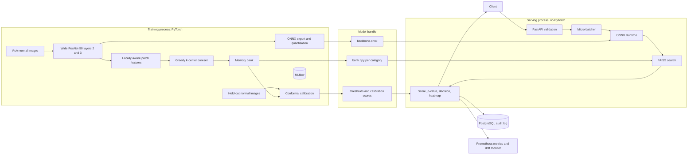
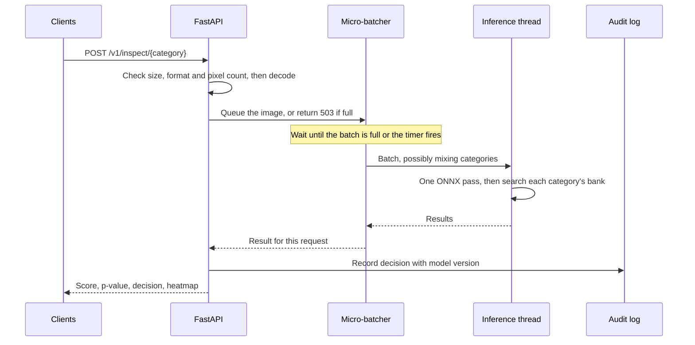

# PatchSentry

**Unsupervised visual anomaly detection for industrial inspection, with calibrated false alarm rates.**

PatchSentry learns what good parts look like and flags anything that deviates, with no defect labels
needed. It combines a from-scratch PatchCore implementation, alarm thresholds set by conformal
prediction, and a PyTorch-free FastAPI service that runs ONNX Runtime and FAISS with dynamic
micro-batching.

[](https://github.com/youssefhipa/patchsentry/actions/workflows/ci.yml)


> Every number in this README comes from a script in this repository, on the public VisA dataset.
> The tables are generated from [`reports/`](reports/) by `make report`, not typed by hand.

---

## Project status and handoff

**To continue this work (human or AI): read this section, then carry on from "Next step".**
Update this section whenever a step is finished, including anything that failed.

| # | Step | Status |
|---|------|--------|
| 1 | Choose project and write this plan | Done |
| 2 | Inspect environment | Done |
| 3 | Scaffold repository, dependencies, git | Done |
| 4 | Download dataset | Done: 10,821 samples, no missing files |
| 5 | Data ingestion and preprocessing | Done |
| 6 | Baselines: autoencoder, PaDiM, image-level k-NN | Done: run on all 12 categories |
| 7 | PatchCore | Done |
| 8 | Sweep on development categories, then full model comparison | Done: 320 px adopted; 72 benchmark runs |
| 9 | Build bundle: ONNX, quantisation, conformal calibration, drift check | Done |
| 10 | Verify the serving path; latency, throughput and load benchmarks | Done, including an int8 load test |
| 11 | FastAPI service | Done; tested, and load-tested on the real bundle |
| 12 | pytest, ruff, mypy | Passing (108 tests) |
| 13 | Docker, Compose, GitHub Actions | CI builds the Docker image on every push. Compose with PostgreSQL has **not** been run locally: Docker's VM did not respond on this 16 GB machine during training |
| 14 | Final README: results and figures | Done |
| 15 | Secret scan, publish public GitHub repo | Done: https://github.com/youssefhipa/patchsentry |

**Next step:** the project is complete. Open items, all optional:
- Run `docker compose up` locally once Docker has free RAM.
- Benchmark on a CUDA GPU.
- Load-test the CoreML execution provider end to end.

If any report needs regenerating, each `make` target writes its own file in `reports/`. Then run
`make figures report`.

**Machine notes (read before running anything on the author's Mac)**
- This folder is on the iCloud-synced Desktop and the disk is nearly full, so macOS evicts files to the
  cloud. A virtualenv here hangs on import, with 0% CPU, while files download again. So heavy files live
  outside iCloud in `~/.local/share/patchsentry` (`venv/`, `data/`, `artifacts/`); `data` and `artifacts`
  here are symlinks to it.
- Run commands with `export UV_PROJECT_ENVIRONMENT=~/.local/share/patchsentry/venv`, and call
  `~/.local/share/patchsentry/venv/bin/python` directly. Do not create `.venv` in this folder.
- 16 GB RAM (the brief says 24), about 3 GB free disk. Docker Desktop holds 39 GB of the user's own images
  and volumes: never prune them. Quit Docker while training, to free its RAM.

**Rules for this project**
- Never fabricate or estimate a result. Tables come from `reports/`, written by committed scripts.
- Never claim something works unless it was run. If something could not be run, say so here.
- Never commit secrets, `.env` files, datasets or large model weights.

---

## Why this project

Production lines have plenty of images of good parts and very few of defects, and new defect types keep
appearing. A supervised detector can't catch a defect it never saw. Getting a model to work is only half
the problem in a real deployment, though:

| Question from the factory | Usual answer | PatchSentry |
|---|---|---|
| How many false alarms will this raise? | A threshold tuned on test data, with no guarantee | Conformal threshold with a finite-sample bound, checked empirically |
| Is the threshold still valid next month? | Nobody checks until complaints arrive | Live drift monitor on conformal p-values |
| Can it keep up with the line? | One benchmark number | Latency and throughput per runtime, plus a load test over HTTP |
| Why did it raise an alarm? | A score | A pixel heatmap and a full audit record |

## Results

Hyperparameters were tuned on **four development categories only**. The headline numbers come from the
**eight held-out categories**, which never influenced any decision. Most anomaly detection results tune on
the reported test set, so they are optimistic by comparison.

### Model comparison

Mean over the eight held-out categories; PatchCore is also averaged over three coreset seeds.

<!-- results:models -->
| Model | Image AUROC | Image F1-max | Pixel AUROC | AUPRO | Image AUROC (all 12) | AUPRO (all 12) | Fit (s) |
|---|---|---|---|---|---|---|---|
| **PatchCore (this project)** | 0.901 | 0.887 | 0.978 | 0.857 | 0.919 | 0.884 | 206 |
| PaDiM | 0.834 | 0.846 | 0.960 | 0.757 | 0.849 | 0.793 | 32 |
| Image-level k-NN | 0.843 | 0.847 | n/a | n/a | 0.841 | n/a | 31 |
| Convolutional autoencoder | 0.646 | 0.767 | 0.863 | 0.626 | 0.661 | 0.610 | 469 |
<!-- /results:models -->

On the held-out categories, PatchCore leads every column. It improves image AUROC by 0.067 over PaDiM and
by 0.058 over image-level k-NN, and AUPRO by 0.10 over PaDiM. The three coreset seeds differ by a standard
deviation of only 0.0013 AUROC. It does not win everywhere, though:

- On **capsules**, **fryum** and **pcb2**, the simple image-level k-NN matches or beats PatchCore at
  *detecting* a defective image. It cannot say *where* the defect is, which is what AUPRO measures.
- **macaroni2** (0.66) and **capsules** (0.72) are hard for every model tested.
- The autoencoder falls below 0.5 on pcb2 and near it on pcb3. It reconstructs defects about as well as
  normal parts, so its error does not separate them.


<details>
<summary>Per-category results</summary>

<!-- results:per_category -->
| Category | Role | PatchCore AUROC | PaDiM AUROC | Autoencoder AUROC | k-NN AUROC | PatchCore AUPRO | PaDiM AUPRO |
|---|---|---|---|---|---|---|---|
| candle | development | 0.963 | 0.923 | 0.652 | 0.894 | 0.964 | 0.952 |
| capsules | held out | 0.717 | 0.576 | 0.621 | 0.739 | 0.734 | 0.537 |
| cashew | development | 0.972 | 0.911 | 0.896 | 0.973 | 0.922 | 0.844 |
| chewinggum | held out | 0.992 | 0.967 | 0.814 | 0.950 | 0.854 | 0.805 |
| fryum | held out | 0.940 | 0.876 | 0.822 | 0.970 | 0.838 | 0.693 |
| macaroni1 | development | 0.912 | 0.779 | 0.766 | 0.640 | 0.917 | 0.826 |
| macaroni2 | held out | 0.663 | 0.665 | 0.577 | 0.504 | 0.824 | 0.685 |
| pcb1 | development | 0.970 | 0.905 | 0.443 | 0.835 | 0.949 | 0.838 |
| pcb2 | held out | 0.958 | 0.906 | 0.360 | 0.967 | 0.913 | 0.865 |
| pcb3 | held out | 0.948 | 0.777 | 0.503 | 0.826 | 0.863 | 0.747 |
| pcb4 | held out | 0.995 | 0.992 | 0.854 | 0.875 | 0.883 | 0.817 |
| pipe_fryum | held out | 0.994 | 0.910 | 0.620 | 0.917 | 0.946 | 0.903 |
<!-- /results:per_category -->
</details>

### Calibrated false alarm rates

<!-- results:conformal -->
| Target false alarm rate | Conformal, resampled splits | Conformal, official test split | Naive threshold (training scores) | Defects caught at this threshold |
|---|---|---|---|---|
| 1.0% | 0.9% | 1.8% | 6.0% | 58.2% |
| 5.0% | 4.7% | 5.0% | 16.8% | 73.9% |
| 10.0% | 9.7% | 9.6% | 26.7% | 80.8% |
<!-- /results:conformal -->

Rates are averaged over all 12 categories. "Resampled" redraws the calibration and test split of normal
images 2,000 times.

- **Conformal thresholds keep their promise.** At a 5% target the observed rate is 4.7% resampled and 5.0%
  on the official split.
- **The naive approach fails badly.** Setting the threshold at a quantile of the training images' scores gives
  16.8%, more than three times the target. Those images built the memory bank, so they score unrealistically
  low.
- **At a 1% target, the official split shows 1.8%.** This is the expected variance of a single small
  calibration set, as the Beta distribution in "How it works" describes, not a broken bound. The average over
  resampled splits is 0.9%.


### Inference performance

Measured on an Apple M3 MacBook Air (16 GB) with real VisA images. No GPU server was available, so CUDA
and TensorRT are **not** benchmarked here.

**Feature extraction by runtime**

<!-- results:backbone -->
| Runtime | Images/s, batch 1 | Images/s, batch 8 | Images/s, batch 16 | Images/s, batch 32 | Latency, batch 1 (ms) |
|---|---|---|---|---|---|
| pytorch-cpu | 20 | 22 | 3 | 3 | 51.1 |
| pytorch-mps | 38 | 36 | 37 | 35 | 26.3 |
| onnx-cpu-float | 6 | 6 | 7 | 7 | 163.4 |
| onnx-cpu-quantized | 22 | 22 | 22 | 22 | 46.2 |
| onnx-coreml | 133 | 139 | 139 | 142 | 7.5 |
<!-- /results:backbone -->

- **CoreML** on the M3 is the fastest runtime, at 139 images/s. That is 20 times the float ONNX CPU path.
- **Int8 quantisation** makes ONNX on CPU 3.7 times faster, with no loss of accuracy (see below).
- **Two results I have not profiled:**
  - Float ONNX on CPU is slower than PyTorch on CPU at small batches.
  - PyTorch on CPU dropped to 3 images/s at batch 16 and above. That may be memory pressure on this
    16 GB machine.


**Nearest-neighbour search**

<!-- results:index -->
| Index | Search p50 (ms/image) | Search p95 (ms/image) | Recall@1 vs exact | Image AUROC | Build (s) | Size (MB) |
|---|---|---|---|---|---|---|
| flat | 38.2 | 39.5 | 1.000 | 0.866 | 0.0 | 44 |
| hnsw | 25.9 | 27.7 | 1.000 | 0.866 | 0.6 | 47 |
| ivf | 75.8 | 84.3 | 1.000 | 0.866 | 0.1 | 45 |
<!-- /results:index -->

The bank of about 44 MB, on candle, pcb1 and macaroni2, is small enough for every index to reach recall 1.0.
**HNSW** searches 1.5 times faster than exact search. IVF is slower than exact search at the settings used,
because it does not pay off at this bank size. Search takes 26 to 38 ms per image, comparable to the int8
backbone, so at 320 px the search is a real share of the latency.

**Quantisation, measured through the deployed path on all 12 categories**

<!-- results:quantization -->
| ONNX graph | Image AUROC | AUPRO | False alarm rate (target 5%) | Defects caught |
|---|---|---|---|---|
| float | 0.917 | 0.884 | 5.0% | 73.9% |
| quantized | 0.918 | 0.889 | 4.2% | 72.3% |
<!-- /results:quantization -->

Int8 quantisation costs nothing measurable: image AUROC is 0.918 against 0.917, and the false alarm rate
stays within its target, using thresholds recalibrated for the int8 graph. Separately, the float ONNX graph
matches PyTorch features to within 4e-6 (`reports/onnx_parity.json`).

**Load test over HTTP** on `pcb1` (CPU execution provider, FAISS flat index), with the client on the same
machine, 30 s per row

<!-- results:loadtest -->
| Configuration | Clients | Requests/s | p50 (ms) | p95 (ms) | p99 (ms) | Mean batch | Errors |
|---|---|---|---|---|---|---|---|
| no-batching | 1 | 5.6 | 179 | 186 | 193 | 1.0 | 0 |
| no-batching | 4 | 5.6 | 708 | 719 | 722 | 1.0 | 0 |
| no-batching | 16 | 5.5 | 2902 | 2947 | 3000 | 1.0 | 0 |
| no-batching | 32 | 5.3 | 5916 | 6160 | 6175 | 1.0 | 0 |
| micro-batching | 1 | 5.1 | 196 | 199 | 210 | 1.0 | 0 |
| micro-batching | 4 | 5.1 | 791 | 821 | 837 | 2.1 | 0 |
| micro-batching | 16 | 5.5 | 2928 | 2997 | 3025 | 7.7 | 0 |
| micro-batching | 32 | 5.2 | 6122 | 6391 | 6418 | 14.8 | 0 |
| quantized-no-batching | 1 | 10.6 | 94 | 96 | 102 | 1.0 | 0 |
| quantized-no-batching | 4 | 11.3 | 350 | 388 | 428 | 1.0 | 0 |
| quantized-no-batching | 16 | 11.4 | 1388 | 1422 | 1491 | 1.0 | 0 |
| quantized-no-batching | 32 | 11.3 | 2781 | 3069 | 3126 | 1.0 | 0 |
| quantized-micro-batching | 1 | 10.1 | 99 | 102 | 105 | 1.0 | 0 |
| quantized-micro-batching | 4 | 11.5 | 345 | 378 | 408 | 2.0 | 0 |
| quantized-micro-batching | 16 | 11.7 | 1354 | 1436 | 1468 | 8.0 | 0 |
| quantized-micro-batching | 32 | 11.6 | 2727 | 2966 | 3032 | 15.4 | 0 |
<!-- /results:loadtest -->


**What the load test shows:**

- **Int8 doubles end-to-end throughput**, from 5.5 to 11.6 requests/s, and halves latency. That is why
  Docker Compose serves the int8 graph by default.
- **Micro-batching does fill batches**, to a mean of 15 at 32 clients, but it adds at most 3% throughput on
  CPU. The runtime table above explains why: on CPU, ONNX Runtime already spreads a single image across every
  core, so images per second are flat across batch sizes. Batching pays off on accelerators, where a batch of
  1 leaves the device idle; CoreML, for example, gains from batch 1 to 32.
- **Hypothesis disproved:** I expected micro-batching to raise CPU throughput, and this result shows it does
  not. What does matter under overload is the bounded queue: it returns `503` instead of letting latency grow
  without limit.
- **Zero errors** across 16 configurations.

### Drift monitoring

<!-- results:drift -->
| Stream | Categories flagged (KS p < 0.001) |
|---|---|
| Clean normal images | 0 of 12 |
| Normal images, 30% darker | 12 of 12 |
| Normal images, defocus blur | 12 of 12 |
<!-- /results:drift -->

The monitor never fired on clean normal streams, and it caught both simulated shifts in every category,
without any labels.

### Hyperparameter sweep

One change at a time from the baseline, on the development categories. The objective is the mean of image
AUROC and AUPRO.

- **Raising the input from 224 to 320 px** gave the largest gain, +0.039 on the objective, at four times the
  search time. It was adopted.
- **Adding ResNet-50 or 512-dim features on top of 320 px** added nothing more.
- **The bank size trades accuracy against speed.** A 0.1% coreset searches 5 times faster but loses 0.06
  objective.
- **A defect fixed along the way:** `reweight_neighbours=1` first gave AUROC 0.50, because of a degenerate
  formula. After the fix, which has a regression test, it scores 0.928. Score reweighting therefore barely
  matters on VisA.

<!-- results:sweep -->
| Change from baseline | Image AUROC | AUPRO | Objective | Fit (s) | Search (ms/image) |
|---|---|---|---|---|---|
| baseline | 0.926 | 0.889 | 0.908 | 80 | 10.3 |
| backbone=resnet18 | 0.921 | 0.902 | 0.912 | 76 | 7.8 |
| backbone=resnet50 | 0.936 | 0.913 | 0.925 | 79 | 11.3 |
| image_size=320 | 0.954 | 0.940 | 0.947 | 159 | 44.3 |
| target_dim=512 | 0.936 | 0.888 | 0.912 | 83 | 9.4 |
| neighbourhood=5 | 0.891 | 0.832 | 0.862 | 85 | 11.5 |
| coreset_fraction=0.001 | 0.878 | 0.813 | 0.846 | 10 | 2.1 |
| coreset_fraction=0.05 | 0.930 | 0.897 | 0.913 | 397 | 61.8 |
| reweight_neighbours=1 | 0.928 | 0.889 | 0.909 | 80 | 11.8 |
| backbone=resnet50,image_size=320 | 0.947 | 0.939 | 0.943 | 140 | 38.7 |
| image_size=320,target_dim=512 | 0.953 | 0.931 | 0.942 | 154 | 37.1 |
<!-- /results:sweep -->

### Example detections

For each category: a typical detection, then the hardest defect, so that failures are visible too.


## Architecture





## How it works

**PatchCore** (Roth et al., CVPR 2022). Mid-level CNN features, average-pooled over a small neighbourhood,
describe each image patch. A memory bank stores what normal patches look like. An image's score comes from
its most unusual patch, meaning the one furthest from any bank entry, scaled down if the matching entry is
itself isolated, since it may be a rare outlier.

**Greedy k-center coreset.** Storing every patch is too slow, so the bank keeps a subset chosen by repeatedly
adding the point furthest from those already chosen. This 2-approximates the optimal covering radius, and
unlike random sampling it keeps rare but normal appearance. A Johnson-Lindenstrauss random projection makes
each step cheaper.

**Split conformal calibration.** Given held-out normal scores `s_1..s_n` that are exchangeable with a new normal
image's score, choosing the threshold as the `k`-th smallest score, where `k = ceil((n+1)(1-alpha))`, gives
`P(false alarm) <= alpha` for any distribution. Two limits matter, and both are measured here:

- The bound averages over calibration sets. For one fixed set, the true rate follows `Beta(n+1-k, k)`.
- It assumes exchangeability, which breaks when the line drifts. The official VisA test split can
  also differ from its training split. That's why the results show both resampled and official-split rates.

**Drift monitor.** Normal images give approximately uniform conformal p-values. The service runs a
Kolmogorov-Smirnov test on a rolling window to detect a shift in the score distribution, without needing labels.

**Micro-batching.** On accelerators, a batched forward pass costs less per image. The first request in an
empty queue starts a short timer, and requests arriving meanwhile share its batch. Under light load, the extra
wait is at most the timer. Under heavy load, batches fill before it fires. On CPU the gain is small; see the
load test.

## Technical decisions and trade-offs

| Decision | Why | Cost |
|---|---|---|
| Tune on 4 categories, report on 8 others | An unbiased estimate; test sets stay untouched | Settings aren't optimal per category |
| Hold out 25% of normal images for calibration | Images in the bank score near zero, which would void the guarantee | A smaller memory bank pool |
| Conformal threshold, not a tuned one | Needs no defect examples and has a provable bound | Controls false alarms only; recall is whatever results |
| Serving image without PyTorch | Smaller image, and export parity is tested instead of assumed | Two runtimes to keep consistent |
| FAISS in serving, PyTorch search in training | The two crash when sharing a process on macOS (reproduced on faiss-cpu 1.8 to 1.15) | Two index code paths, so `verify_serving.py` checks the deployed one end to end |
| Fixed 1x1 convolution for channel pooling | Exports cleanly to ONNX, unlike adaptive pooling over channels | Slightly less flexible |
| Square resize, no centre crop | Defects at part edges stay visible | Mild aspect-ratio distortion |
| One uvicorn worker | The batcher is per process, and workers would split traffic into smaller batches | Scale out with container replicas |
| Hash, not image, in the audit log | Production images can be commercially sensitive | Images must be archived elsewhere to replay them |
| No Redis or message queue | An in-process queue is enough for one model server and avoids a failure point | Queued requests are lost if the process crashes |

## Quick start

### Run the API with Docker

The bundle is mounted at run time, so build it first (below). Then:

```bash
cp .env.example .env     # set POSTGRES_PASSWORD
docker compose up --build
curl http://127.0.0.1:8000/readyz
```

### Reproduce everything

Requires [uv](https://docs.astral.sh/uv/) and about 5 GB of disk. Dependencies are pinned in `uv.lock`.

```bash
make install
make data        # downloads VisA, 1.9 GB
make test lint
make all         # every experiment, benchmark, figure and README table
make serve       # API at http://127.0.0.1:8000, interactive docs at /docs
```

MLflow runs are stored in `artifacts/mlflow.db`. View them with
`mlflow ui --backend-store-uri sqlite:///artifacts/mlflow.db`.

## API

Interactive OpenAPI docs are served at `/docs`.

| Method | Path | Purpose |
|---|---|---|
| `POST` | `/v1/inspect/{category}` | Inspect one image. Add `?include_heatmap=true` for a heatmap |
| `GET` | `/v1/categories` | Models, thresholds and calibration sizes |
| `GET` | `/v1/inspections/{id}` | Read an audit record |
| `GET` | `/v1/drift/{category}` | Drift status from recent p-values |
| `GET` | `/healthz`, `/readyz` | Liveness and readiness |
| `GET` | `/metrics` | Prometheus metrics |

```bash
curl -X POST "http://127.0.0.1:8000/v1/inspect/pcb1" -F "file=@part.jpg"
```

Response fields:

| Field | Meaning |
|---|---|
| `inspection_id` | Key of the audit record |
| `anomaly_score` | PatchCore score; higher is more anomalous |
| `p_value` | How unusual this score is among held-out normal images |
| `threshold` | Alarm threshold in force |
| `target_false_alarm_rate` | The rate the threshold was calibrated for |
| `is_anomalous` | The decision |
| `latency_ms`, `model_version` | Operational metadata |
| `heatmap_png_base64` | Heatmap, if requested |

| Status | When |
|---|---|
| `400` | Empty or unreadable file |
| `404` | Unknown category |
| `413` | Upload or pixel count over the limit (checked before decoding) |
| `415` | Unsupported image format |
| `422` | Missing file field |
| `503` | Inference queue full |
| `504` | Inference timed out |

## Repository structure

```
src/patchsentry/
  conformal.py, metrics.py   Conformal calibration, AUROC, AUPRO, F1-max (NumPy)
  data/                      Resumable download, VisA parsing, shared preprocessing
  models/                    Features, coreset, PatchCore index, baselines
  pipeline/                  Sweep, benchmark, bundle, verification, load test, reports
  serving/                   FastAPI app, micro-batcher, engine, audit log
tests/
  training/                  Runs with PyTorch
  serving/                   Runs with FAISS and no PyTorch
configs/  reports/  Dockerfile  docker-compose.yml  .github/workflows/ci.yml
```

## Dataset and licences

- **Dataset:** [VisA](https://github.com/amazon-science/spot-the-difference) (Zou et al., ECCV 2022), Amazon,
  [CC BY 4.0](https://creativecommons.org/licenses/by/4.0/). It has 10,821 images across 12 categories, and this
  project uses its official one-class split. The dataset is downloaded by script and isn't stored in this
  repository. The example images in `reports/figures/gallery.png` are from VisA, resized and overlaid with heatmaps.
- **Pretrained weights:** torchvision ImageNet weights.
- **Code:** MIT, see [LICENSE](LICENSE).

## Limitations

- Inputs are 320 px, while VisA originals are about 1500 px, so very small defects can disappear. The gallery
  shows such misses. Published VisA results often use other resolutions, and some tune on the test set, so
  compare with care.
- Some categories remain hard: macaroni2 scores 0.66 image AUROC and capsules 0.72.
- Throughput on CPU is about 11 images/s per container with int8, which is enough for one slow line, not a
  fast one. CoreML reached 139 images/s for the backbone, but the full service was load-tested only on CPU.
- Benchmarks come from one laptop. CUDA and TensorRT paths are configurable through ONNX Runtime providers but
  **untested**.
- The conformal bound covers false alarms only and requires exchangeability. Drift voids it until recalibration.
- Each product needs its own memory bank and about 100 or more held-out normal images for a 1% target.
- Drift detection can't distinguish a changed camera from a real surge in defects. It raises a flag, not a diagnosis.
- The API has no authentication or rate limiting, and it binds to localhost in Compose. Add a gateway before exposing it.

## Future improvements

- Benchmark CUDA and TensorRT on a GPU server.
- Conditional calibration per lighting or product batch, with automatic recalibration after drift.
- Product quantisation of the bank, to shrink memory use for many products.
- Multi-resolution scoring for small defects.

## References

- Roth et al., *Towards Total Recall in Industrial Anomaly Detection*, CVPR 2022.
- Defard et al., *PaDiM: a Patch Distribution Modeling Framework*, ICPR 2021.
- Zou et al., *SPot-the-Difference Self-Supervised Pre-training for Anomaly Detection and Segmentation*, ECCV 2022.
- Vovk et al., *Algorithmic Learning in a Random World*, 2005; Bates et al., *Testing for Outliers with Conformal p-values*, Annals of Statistics 2023.
- Gonzalez, *Clustering to Minimize the Maximum Intercluster Distance*, TCS 1985.
